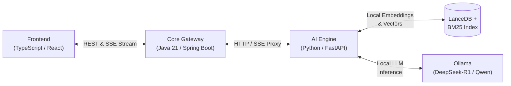

# Local RAG: Enterprise Polyglot Architecture

A production-grade, local **Retrieval-Augmented Generation (RAG)** platform designed to demonstrate modern AI Engineering patterns across **Java 21**, **Python 3.13**, and **TypeScript**.

---

## Architecture Overview



### Modules

1. **`services/ai-service/` (Python 3.13 + `uv`)**
   - Ingestion, hierarchical recursive chunking, FastEmbed (ONNX) local embeddings.
   - LanceDB embedded columnar vector database + BM25 keyword index.
   - Reciprocal Rank Fusion (RRF) hybrid search + FlashRank Cross-Encoder re-ranking.
   - Grounded prompt construction and Ollama LLM streaming with bracketed citations.

2. **`services/core-service/` (Java 21 + Spring Boot 3)**
   - Enterprise API gateway and orchestration layer.
   - Document lifecycle & metadata persistence, conversational session memory.
   - Non-blocking Server-Sent Events (SSE) streaming proxy and fault-tolerant HTTP client.

3. **`services/web-ui/` (TypeScript + React / Vite)**
   - Conversational chat interface with real-time token streaming.
   - Document manager with drag-and-drop upload.
   - Interactive Chunk Inspector: visual breakdown of how documents were parsed and scored.
   - Clickable citation pills with exact source snippet highlights.

---

## Getting Started

### Prerequisites
- Python >= 3.13 and [`uv`](https://docs.astral.sh/uv/)
- Java >= 21 and Maven
- Node.js >= 20 and npm
- [Ollama](https://ollama.com/) running locally (`ollama run deepseek-r1:latest` or `qwen2.5:7b`)

### 1. Test the AI Service Pipeline
```bash
cd services/ai-service
uv run python tests/test_pipeline.py
```

### 2. Start the AI Service
```bash
cd services/ai-service
uv run python main.py
# Running on http://127.0.0.1:8000 (Swagger docs at /docs)
```

### 3. Test & Start the Core Gateway Service (Java 21 / Spring Boot)
```bash
cd services/core-service
./mvnw test
./mvnw spring-boot:run
# Running on http://127.0.0.1:8080
```
